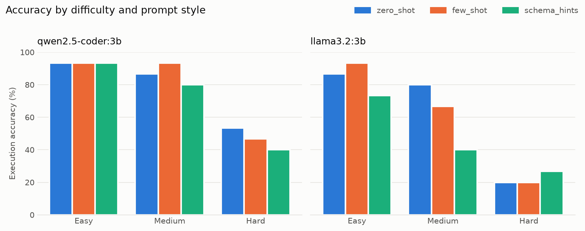
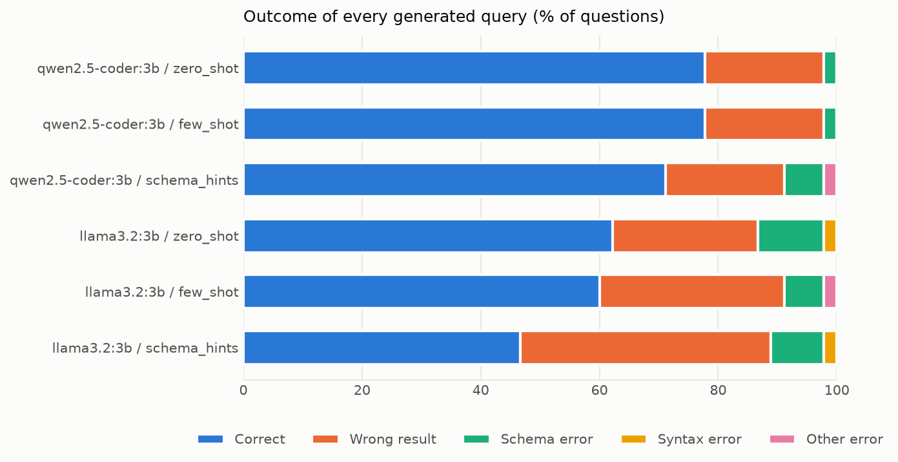
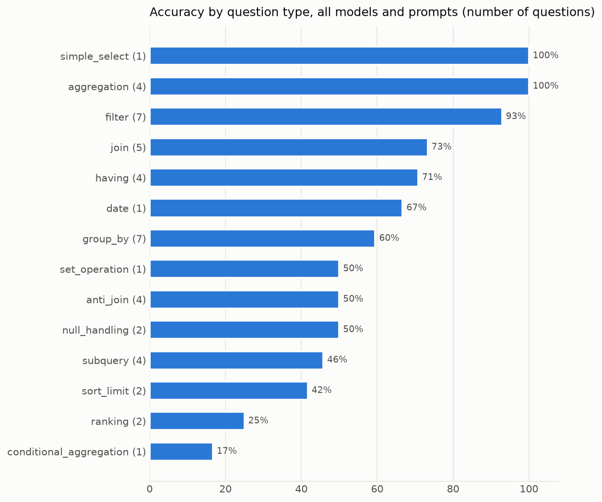
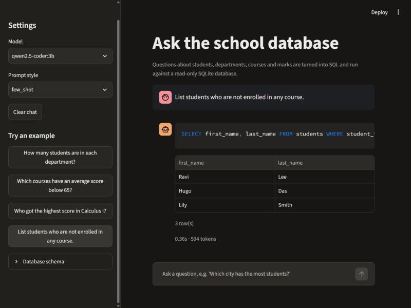

# Text-to-SQL Evaluator

A chatbot that turns plain-English questions into SQL for a small school database, and an
evaluator that grades local open models by **execution accuracy**: each model's SQL is run
against the database and its result is compared with the result of a hand-written reference
query. Two models are compared across three prompt styles on a 45-question benchmark.



## Results

45 questions × 2 models × 3 prompt styles = 270 generated queries, run locally on an
RTX 3050 Ti Laptop GPU (4GB). Full report with every table: [results/report.md](results/report.md).

| Model | Prompt | Accuracy | Easy | Medium | Hard | Failed to run | Median latency | Avg prompt tokens |
|---|---|---:|---:|---:|---:|---:|---:|---:|
| qwen2.5-coder:3b | zero_shot | **77.8%** | 93.3% | 86.7% | **53.3%** | 2.2% | 0.44s | 424 |
| qwen2.5-coder:3b | few_shot | **77.8%** | 93.3% | **93.3%** | 46.7% | 2.2% | 0.39s | 582 |
| qwen2.5-coder:3b | schema_hints | 71.1% | 93.3% | 80.0% | 40.0% | 8.9% | **0.32s** | 938 |
| llama3.2:3b | zero_shot | 62.2% | 86.7% | 80.0% | 20.0% | 13.3% | 0.67s | 432 |
| llama3.2:3b | few_shot | 60.0% | 93.3% | 66.7% | 20.0% | 8.9% | 0.61s | 590 |
| llama3.2:3b | schema_hints | 46.7% | 73.3% | 40.0% | 26.7% | 11.1% | 0.64s | 912 |

**What we learned**

- **A code-tuned model beats a general model of the same size.** Qwen2.5-Coder 3B is about
  16 points more accurate than Llama 3.2 3B and has a much lower failed-to-run rate
  (2% vs 9–13%). Llama's failures are mostly made-up or ambiguous column names.
- **Hard questions are where models separate.** With the zero-shot and few-shot prompts both
  models get over 85% of easy questions right, but on hard questions Qwen reaches 40–53% and Llama 20–27%.
- **More prompt context is not always better.** The `schema_hints` prompt, with sample rows
  and data conventions, doubles the prompt length and *lowers* accuracy for both models.
  Llama over-applied the hints, for example wrapping columns in `ROUND()` when no rounding
  was asked for (`SELECT ROUND(course_id, 0) AS code ...`). Few-shot examples helped Qwen on
  medium questions but did not help Llama.
- **Most-failed question types:** conditional aggregation (17%), ranking / top-per-group
  (25%), sorting with LIMIT (42%) and subqueries (46%).
  - Every configuration got "the 5 youngest students" wrong, sorting birth dates ascending
    instead of descending.
  - Common logic mistakes: `COUNT(*)` on a `LEFT JOIN` counts empty courses as 1; a
    `WHERE email IS NULL` filter after a `LEFT JOIN` drops departments with a count of zero;
    "all scores ≥ 60" was written as "any score ≥ 60".
- **Execution accuracy caught a benchmark bug.** In the first run, models that used
  `SELECT DISTINCT first_name, last_name` were marked wrong because two different students
  are both called Olivia Novak. The question was changed to also ask for `student_id`, and
  the whole experiment was re-run.




### Chatbot



## How it works

```
questions.jsonl ─┐
schema ──────────┼─► prompt builder (3 styles) ─► Ollama model ─► SQL extractor
                 │                                                    │
                 │          school.db (read-only, timeout)            ▼
                 └─ gold SQL ─────────────► grader ◄────────── predicted SQL
                                              │
                         correct / wrong_result / syntax_error /
                         schema_error / execution_error / timeout / no_sql
                                              ▼
                               results/*.jsonl ─► analysis ─► report.md + charts
```

**Database** (`data/schema.sql`, `data/seed.py`): `departments`, `students`, `courses`,
`marks`. 50 students, 12 courses, 166 marks, generated from a fixed seed. The data has
deliberate edge cases: ungraded marks (`NULL` scores), students without an email, students
with no enrollments and a course nobody takes.

**Benchmark** (`data/questions.jsonl`): 45 questions, 15 each of easy, medium and hard.
Each has a reference SQL query and a type label (filter, aggregation, join, group_by,
having, subquery, anti_join, ranking, set_operation, null_handling, date, …).
`python -m src.benchmark -v` checks every reference query runs and returns rows.

**Prompt styles** (`src/prompts.py`)
| Style | What the model sees |
|---|---|
| `zero_shot` | schema + question |
| `few_shot` | schema + 3 worked examples + question |
| `schema_hints` | schema + sample rows + allowed values and data conventions + question |

**Grading rules** (`src/grader.py`)
- Rows are compared as a multiset; order matters only if the reference query has a
  top-level `ORDER BY`.
- Numbers are rounded to 2 decimals before comparing; column names and column order are ignored.
- The database is opened read-only and every query has a 5-second limit.
- A query that fails is labelled `syntax_error`, `schema_error` (unknown table or column),
  `execution_error`, `timeout` or `no_sql`. All of these count as "failed to run".

**Models** (run locally through [Ollama](https://ollama.com), 4-bit quantized, temperature 0)
| Model | Type | License |
|---|---|---|
| `qwen2.5-coder:3b` | code-tuned | Qwen Research License (non-commercial) |
| `llama3.2:3b` | general instruction-tuned | Llama 3.2 Community License |

## Setup

Requires Python 3.11+ and [Ollama](https://ollama.com). Tested on Windows with an
RTX 3050 Ti Laptop GPU (4GB VRAM).

```powershell
python -m venv .venv
.\.venv\Scripts\Activate.ps1
pip install -r requirements.txt
ollama pull qwen2.5-coder:3b
ollama pull llama3.2:3b
python data/seed.py
```

## Usage

```powershell
# Check the benchmark and run the unit tests
python -m src.benchmark -v
pytest

# Full experiment: 2 models x 3 prompts x 45 questions
python -m src.run_eval --out results/final_run.jsonl

# Smaller runs
python -m src.run_eval --models qwen2.5-coder:3b --prompts few_shot --limit 10

# Build results/report.md and the charts
python -m src.analyze results/final_run.jsonl

# Chatbot
streamlit run app/chat.py
```

## Project structure

```
data/      schema.sql, seed.py (builds school.db), questions.jsonl
src/       db.py, benchmark.py, prompts.py, llm.py, extract.py, grader.py, run_eval.py, analyze.py
app/       chat.py (Streamlit chatbot)
tests/     grader, extractor, prompt and benchmark tests
results/   final_run.jsonl, report.md, charts/
```

## Limitations

- 45 questions is small: one question is about 2 percentage points of accuracy, so small
  differences between configurations are not meaningful.
- Execution accuracy can give credit to a wrong query that happens to return the right rows
  on this particular data.
- Latency was measured on one laptop GPU and includes Ollama's HTTP overhead.
