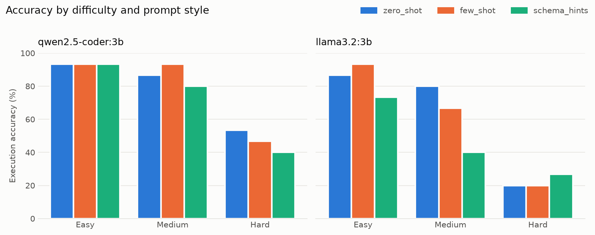
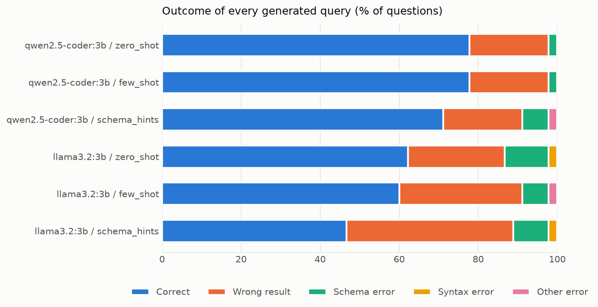
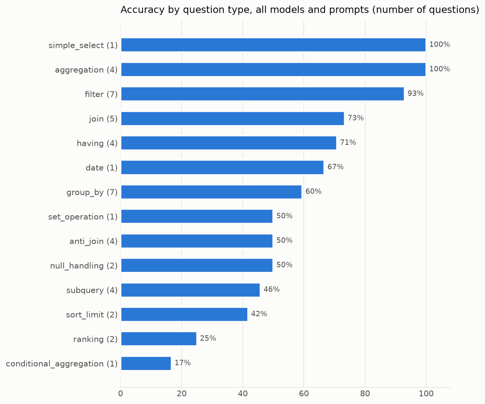

# Results

Source: `results/final_run.jsonl` — 45 questions × 2 models × 3 prompt styles = 270 generated queries. Temperature 0, seed 42.

## Key findings

- **Best configuration:** qwen2.5-coder:3b with the `few_shot` prompt — 77.8% execution accuracy, 2.2% of queries failed to run.
- **Hardest question type:** `conditional_aggregation` — 16.7% accuracy across all configurations.
- **Overall failed-to-run rate:** 7.8% (most common error: `schema_error`).

## Summary by model and prompt

| model            | prompt_style   |   accuracy_% |   failed_to_run_% |   median_latency_s |   p95_latency_s |   avg_prompt_tokens |   avg_completion_tokens |
|:-----------------|:---------------|-------------:|------------------:|-------------------:|----------------:|--------------------:|------------------------:|
| qwen2.5-coder:3b | zero_shot      |         77.8 |               2.2 |               0.44 |            0.8  |                 424 |                    32.2 |
| qwen2.5-coder:3b | few_shot       |         77.8 |               2.2 |               0.39 |            0.7  |                 582 |                    29.5 |
| qwen2.5-coder:3b | schema_hints   |         71.1 |               8.9 |               0.32 |            0.9  |                 938 |                    31.3 |
| llama3.2:3b      | zero_shot      |         62.2 |              13.3 |               0.67 |            1.93 |                 432 |                    42.9 |
| llama3.2:3b      | few_shot       |         60   |               8.9 |               0.61 |            1.28 |                 590 |                    32.3 |
| llama3.2:3b      | schema_hints   |         46.7 |              11.1 |               0.64 |            1.67 |                 912 |                    40.1 |

## Accuracy by difficulty (%)

| model            | prompt_style   |   easy |   medium |   hard |
|:-----------------|:---------------|-------:|---------:|-------:|
| qwen2.5-coder:3b | zero_shot      |   93.3 |     86.7 |   53.3 |
| qwen2.5-coder:3b | few_shot       |   93.3 |     93.3 |   46.7 |
| qwen2.5-coder:3b | schema_hints   |   93.3 |     80   |   40   |
| llama3.2:3b      | zero_shot      |   86.7 |     80   |   20   |
| llama3.2:3b      | few_shot       |   93.3 |     66.7 |   20   |
| llama3.2:3b      | schema_hints   |   73.3 |     40   |   26.7 |

## Outcomes

| model            | prompt_style   |   correct |   execution_error |   schema_error |   syntax_error |   wrong_result |
|:-----------------|:---------------|----------:|------------------:|---------------:|---------------:|---------------:|
| llama3.2:3b      | few_shot       |        27 |                 1 |              3 |              0 |             14 |
| llama3.2:3b      | schema_hints   |        21 |                 0 |              4 |              1 |             19 |
| llama3.2:3b      | zero_shot      |        28 |                 0 |              5 |              1 |             11 |
| qwen2.5-coder:3b | few_shot       |        35 |                 0 |              1 |              0 |              9 |
| qwen2.5-coder:3b | schema_hints   |        32 |                 1 |              3 |              0 |              9 |
| qwen2.5-coder:3b | zero_shot      |        35 |                 0 |              1 |              0 |              9 |

## Accuracy by question type (%)

| question_type           |   llama3.2:3b |   qwen2.5-coder:3b |   all_configs |   n_questions |
|:------------------------|--------------:|-------------------:|--------------:|--------------:|
| conditional_aggregation |           0   |               33.3 |          16.7 |             1 |
| ranking                 |           0   |               50   |          25   |             2 |
| sort_limit              |          33.3 |               50   |          41.7 |             2 |
| subquery                |          25   |               66.7 |          45.8 |             4 |
| null_handling           |          50   |               50   |          50   |             2 |
| anti_join               |          50   |               50   |          50   |             4 |
| set_operation           |           0   |              100   |          50   |             1 |
| group_by                |          52.4 |               66.7 |          59.5 |             7 |
| date                    |          33.3 |              100   |          66.7 |             1 |
| having                  |          66.7 |               75   |          70.8 |             4 |
| join                    |          60   |               86.7 |          73.3 |             5 |
| filter                  |          85.7 |              100   |          92.9 |             7 |
| aggregation             |         100   |              100   |         100   |             4 |
| simple_select           |         100   |              100   |         100   |             1 |

## Hardest questions

| question_id   | difficulty   | question_type           | question                                                                                                                                             |   correct_configs |   total_configs |
|:--------------|:-------------|:------------------------|:-----------------------------------------------------------------------------------------------------------------------------------------------------|------------------:|----------------:|
| e14           | easy         | sort_limit              | Show the first and last names of the 5 youngest students, youngest first.                                                                            |                 0 |               6 |
| h04           | hard         | ranking                 | For each department, which student in that department has the highest average score? Show the department name and the student's first and last name. |                 0 |               6 |
| h07           | hard         | having                  | List the first and last names of students who are enrolled in courses from at least 3 different departments.                                         |                 0 |               6 |
| h11           | hard         | anti_join               | List the first and last names of students who are enrolled in at least one course but in no course offered by the Computer Science department.       |                 0 |               6 |
| h13           | hard         | subquery                | On average, how many courses is each enrolled student taking? Round to 2 decimal places.                                                             |                 0 |               6 |
| h14           | hard         | null_handling           | For every department, show the department name and how many of its students have no email address. Include departments where that number is zero.    |                 0 |               6 |
| h15           | hard         | anti_join               | List the first and last names of students who have at least one graded mark and whose graded scores are all 60 or higher.                            |                 0 |               6 |
| h08           | hard         | conditional_aggregation | For each course code, what percentage of its graded marks are 50 or above? Round the percentage to 1 decimal place.                                  |                 1 |               6 |
| h12           | hard         | group_by                | Which instructor has the most enrollments in total across all the courses they teach? Show the instructor and the number of enrollments.             |                 1 |               6 |
| h03           | hard         | subquery                | List the first and last names of students whose average score is higher than the average of all scores.                                              |                 2 |               6 |

## Example failures

| question_id   | model            | prompt_style   | status       | pred_sql                                                                                                                 | error                             |
|:--------------|:-----------------|:---------------|:-------------|:-------------------------------------------------------------------------------------------------------------------------|:----------------------------------|
| e14           | qwen2.5-coder:3b | zero_shot      | wrong_result | SELECT first_name, last_name FROM students ORDER BY date_of_birth ASC LIMIT 5                                            |                                   |
| m03           | qwen2.5-coder:3b | zero_shot      | wrong_result | SELECT c.code, AVG(CASE WHEN m.score IS NOT NULL THEN m.score ELSE 0 END) AS average_score FROM courses c LEFT JOIN mark |                                   |
| m12           | qwen2.5-coder:3b | zero_shot      | schema_error | SELECT student_id, SUM(credits) AS total_credits FROM students JOIN marks ON students.student_id = marks.student_id JOIN | ambiguous column name: student_id |
| h04           | qwen2.5-coder:3b | zero_shot      | wrong_result | SELECT d.name, s.first_name, s.last_name FROM students s JOIN departments d ON s.dept_id = d.dept_id JOIN ( SELECT stude |                                   |
| h07           | qwen2.5-coder:3b | zero_shot      | wrong_result | SELECT DISTINCT T1.first_name, T1.last_name FROM students AS T1 INNER JOIN marks AS T2 ON T1.student_id = T2.student_id  |                                   |
| h11           | qwen2.5-coder:3b | zero_shot      | wrong_result | SELECT first_name, last_name FROM students WHERE student_id NOT IN (SELECT student_id FROM marks WHERE course_id IN (SEL |                                   |
